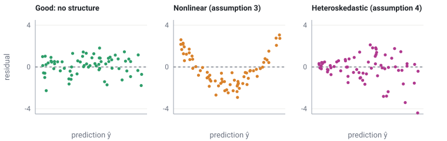

# Linear Regression

$$
Y = \beta^\top X + \varepsilon, \qquad \varepsilon \overset{\text{iid}}{\sim} \mathcal{N}(0, \sigma^2)
$$

---

## Estimation

```derivation
\hat\beta & = \arg\min_\beta \sum_{i=1}^{n} \big(Y_i - X_i^\top \beta\big)^2 || || OLS: minimize the sum of squares
& = (X^\top X)^{-1} X^\top Y || || [!NOTE] analytical solution :: Set the gradient $-2X^\top(Y - X\beta)$ to zero: the normal equations $X^\top X \beta = X^\top Y$.
```

## Why OLS

```derivation
\beta^* & = \arg\min_\beta\, \mathbb{E}\big[(Y - \beta^\top X)^2\big] || || best linear predictor; OLS is its sample version
\hat\beta_{\text{MLE}} & = \arg\max_\beta \Big[-\frac{1}{2\sigma^2} \sum_i \big(Y_i - X_i^\top\beta\big)^2\Big] = \hat\beta_{\text{OLS}} || || OLS = MLE under Gaussian errors
\mathrm{Var}(\hat\beta_{\text{OLS}}) & \preceq \mathrm{Var}(\tilde\beta) \quad \forall\ \text{linear unbiased}\ \tilde\beta || || [!NOTE] most efficient :: Gauss–Markov: under assumptions 1–4, OLS is BLUE, the lowest-variance *linear* unbiased estimator. Add normal errors (5) and it's the lowest-variance among *all* unbiased estimators.
```

---

## Assumptions

| | assumption | math | buys you | if violated |
|---|---|---|---|---|
| 1 | i.i.d. errors | $\varepsilon_i$ i.i.d. | the statistics work at all | no check: understand the data-generating process; reframe the question |
| 2 | no perfect collinearity | $X^\top X$ invertible | $\hat\beta$ exists | can't invert the design matrix: drop features (or regularize) |
| 3 | linear, zero-mean errors | $\mathbb{E}[\varepsilon \mid X] = 0$ | **1–3 ⇒ $\hat\beta$ unbiased** | structure in residuals vs. predictions |
| 4 | homoskedasticity | $\mathrm{Var}[\varepsilon \mid X] = \sigma^2$ | classical standard errors | eye test or statistical tests; use robust SEs |
| 5 | normal errors | $\varepsilon \sim \mathcal{N}(0, \sigma^2)$ | exact $t$- and $F$-tests | QQ plot; no exact hypothesis tests. Hard to tell apart from missing predictors; usually use robust SEs |

<figure>
  
  <figcaption>Residuals vs. predictions. Good: no structure. A curve means a missing nonlinearity or predictor (3). A funnel means the variance grows with ŷ (4).</figcaption>
</figure>

---

## Standard errors

```derivation
\mathrm{SE}(\hat\beta_j) & = \sqrt{\mathrm{Var}(\hat\beta)_{jj}} || || confidence intervals on coefficients
\mathrm{Var}(\hat\beta) & = \sigma^2 (X^\top X)^{-1} || || homoskedastic (4); $\hat\sigma^2 = \mathrm{RSS}/(n - p)$
\mathrm{Var}(\hat\beta) & = (X^\top X)^{-1} \Big(\sum_i \hat\varepsilon_i^2\, x_i x_i^\top\Big) (X^\top X)^{-1} || || [!NOTE] robust (sandwich) :: White / HC0 standard errors. Valid without homoskedasticity: each residual weights its own row instead of one shared $\sigma^2$.
```

## Hypothesis tests

```derivation
t_j & = \frac{\hat\beta_j}{\mathrm{SE}(\hat\beta_j)} \sim t_{n-p} || || [!ASSUMPTION] normal errors :: Exact only if errors are normal (5). With large $n$ the tests hold approximately (CLT).
F & = \frac{(\mathrm{RSS}_{\text{reduced}} - \mathrm{RSS}_{\text{full}})\,/\,q}{\mathrm{RSS}_{\text{full}}\,/\,(n - p)} \sim F_{q,\, n-p} || || fit a full and a reduced model ($q$ fewer coefficients)
```

---

## Good questions

<details class="q">
<summary>In what sense is OLS the "best" estimator?</summary>

With no assumptions, it's the best linear *predictor* (a projection). Under assumptions 1–4, Gauss–Markov makes it the lowest-variance *linear* unbiased estimator. Add normal errors and it's the MLE and the best of *all* unbiased estimators.

</details>

<details class="q">
<summary>Does heteroskedasticity bias the coefficients?</summary>

No: $\hat\theta$ stays unbiased. The classical standard errors are wrong, so the t-tests are too. Use robust (sandwich) standard errors or weighted least squares.

</details>

<details class="q">
<summary>What happens with perfectly or nearly collinear features?</summary>

Perfect: $X^\top X$ is singular and there's no unique solution. Nearly: the solution exists but its variance explodes, and coefficients flip sign between samples. Ridge fixes both.

</details>

<details class="q">
<summary>Why squared error rather than absolute error?</summary>

Squared error = Gaussian MLE, has a closed form and estimates the conditional *mean*. Absolute error = Laplace MLE, estimates the conditional *median* and is more robust to outliers.

</details>
