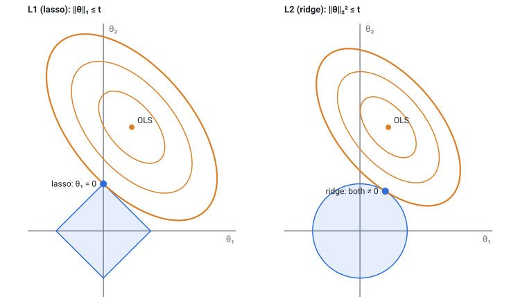

# Regularized Regression

Penalize the coefficients to prevent overfitting: **increase bias, decrease variance**.

```derivation
L_{\text{L1}}(\theta) & = L_{\text{OLS}}(\theta) + \lambda \lVert\theta\rVert_1 || || lasso; $\lVert\theta\rVert_1 = \sum_j \lvert\theta_j\rvert$
L_{\text{L2}}(\theta) & = L_{\text{OLS}}(\theta) + \lambda \lVert\theta\rVert_2^2 || || ridge; $\lVert\theta\rVert_2^2 = \sum_j \theta_j^2$
```

---

## L1 vs. L2

```derivation
\frac{\partial}{\partial \theta_j}\, \lambda \lVert\theta\rVert_1 & = \lambda\, \mathrm{sign}(\theta_j) || || [!INTUITION] sparsity :: A constant push of size $\lambda$ that doesn't shrink as $\theta_j \to 0$, so many weights land exactly at 0. Useful for feature selection.
\frac{\partial}{\partial \theta_j}\, \lambda \lVert\theta\rVert_2^2 & = 2\lambda\, \theta_j || || [!INTUITION] shrinkage :: A push proportional to $\theta_j$: weights decay smoothly toward 0 but rarely reach it.
\hat\theta_{\text{ridge}} & = (X^\top X + \lambda I)^{-1} X^\top Y || || closed form; invertible for any $\lambda > 0$, even with collinear features
```

<figure>
  
  <figcaption>Constrained view: minimize the loss inside a budget ‖θ‖ ≤ t. The loss contours (orange) first touch the L1 diamond at a corner, where a coefficient is exactly 0. The L2 disk has no corners, so the solution is off-axis.</figcaption>
</figure>

---

## Regularization = MAP

```derivation
\hat\theta_{\text{MAP}} & = \arg\max_\theta \big[\log p(Y \mid X, \theta) + \log p(\theta)\big] || || posterior ∝ likelihood × prior
& = \arg\min_\theta \big[L_{\text{OLS}}(\theta) - 2\sigma^2 \log p(\theta)\big] || || Gaussian likelihood; $L_{\text{OLS}}$ = sum of squares
\theta_j \sim \mathcal{N}(0, \tau^2) & \;\Rightarrow\; \lambda \lVert\theta\rVert_2^2, \quad \lambda = \sigma^2 / \tau^2 || || ridge = Gaussian prior
\theta_j \sim \mathrm{Laplace}(0, b) & \;\Rightarrow\; \lambda \lVert\theta\rVert_1, \quad \lambda = 2\sigma^2 / b || || lasso = Laplace prior
```

---

## Good questions

<details class="q">
<summary>Why does L1 set weights exactly to zero while L2 only shrinks them?</summary>

L1's pull toward zero has constant strength $\lambda$, even for tiny weights, so it pushes them all the way. L2's pull $2\lambda\theta$ fades as $\theta \to 0$. Geometrically: the loss contours hit the diamond's corners.

</details>

<details class="q">
<summary>Why standardize features before regularizing?</summary>

The penalty is on the size of $\theta$, and that size depends on the feature's units. Without scaling, the amount of shrinkage per feature is arbitrary.

</details>

<details class="q">
<summary>Two highly correlated features: what do lasso and ridge do?</summary>

Lasso tends to keep one and zero the other, somewhat arbitrarily. Ridge splits the weight between them. Elastic net (L1 + L2) gets sparsity without the arbitrary pick.

</details>

<details class="q">
<summary>What is the regularization strength in Bayesian terms?</summary>

The ratio of noise variance to prior variance ($\lambda = \sigma^2 / \tau^2$ for ridge). A tighter prior or noisier data means more regularization.

</details>
