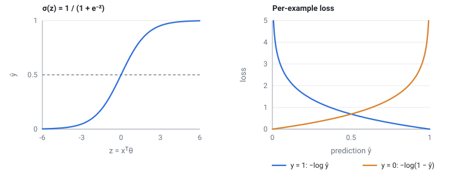

# Logistic Regression & Cross-Entropy

$$
\hat y = P(y = 1 \mid x) = \sigma(x^\top \theta), \qquad \sigma(z) = \frac{1}{1 + e^{-z}}
$$

---

## MLE = binary cross-entropy

```derivation
p(Y \mid X, \theta) & = \prod_{i=1}^{n} \hat y_i^{\,y_i} (1 - \hat y_i)^{1 - y_i} || || Bernoulli likelihood
L(\theta) = -\log p & = -\sum_{i=1}^{n} \big[\, y_i \log \hat y_i + (1 - y_i) \log (1 - \hat y_i) \,\big] || || [!INTUITION] one term at a time :: $y_i \in \{0, 1\}$, so only one term is on for each example: $-\log \hat y_i$ if $y_i = 1$, $-\log(1 - \hat y_i)$ if $y_i = 0$.
\nabla_\theta L & = \sum_i (\hat y_i - y_i)\, x_i = X^\top (\hat Y - Y) || || convex, but no closed form: gradient descent
```

<figure>
  
  <figcaption>Left: the sigmoid squashes the score into a probability. Right: the loss for each label. Confident wrong predictions are punished without bound.</figcaption>
</figure>

---

## Cross-entropy & KL divergence

```derivation
D_{\mathrm{KL}}(p \,\Vert\, q) & = \sum_x p(x) \log \frac{p(x)}{q(x)} || || [!NOTE] information lost :: Distance between distributions: the information lost when $q$ is used to approximate $p$. $\geq 0$, $= 0$ iff $p = q$, and not symmetric.
& = H(p, q) - H(p) || || cross-entropy − entropy
H(p, q) & = -\sum_x p(x) \log q(x) || || cross-entropy
H(p) & = -\sum_x p(x) \log p(x) || || entropy
\arg\min_q H(p, q) & = \arg\min_q D_{\mathrm{KL}}(p \,\Vert\, q) || || [!INTUITION] why cross-entropy :: $H(p)$ doesn't depend on the model, so minimizing cross-entropy = minimizing KL to the data. BCE is the cross-entropy between the label $p = (y,\, 1 - y)$ and the prediction $q = (\hat y,\, 1 - \hat y)$.
```
