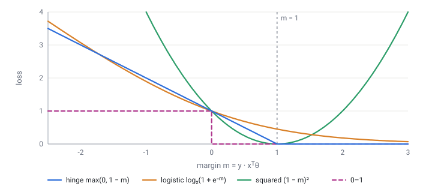

# Support Vector Machines

Labels $y_i \in \{-1, +1\}$, score $f(x) = x^\top \theta$, margin $m_i = y_i\, x_i^\top \theta$.

```derivation
L_{\text{SVM}}(\theta) & = \sum_i \max\big(0,\ 1 - y_i\, x_i^\top \theta\big) + \lambda \lVert\theta\rVert^2 || || minimize the hinge loss + L2
& \Leftrightarrow\ \min_{\theta,\, \xi}\ \tfrac{1}{2}\lVert\theta\rVert^2 + C \sum_i \xi_i || || [!INTUITION] max margin :: The soft-margin SVM: slack $\xi_i$ is the hinge loss. The margin width is $2 / \lVert\theta\rVert$, so the L2 term maximizes the margin.
\text{s.t.} & \quad y_i\, x_i^\top\theta \geq 1 - \xi_i, \quad \xi_i \geq 0 || || slack $\xi_i$ per point
```

<figure>
  
  <figcaption>Losses vs. margin. Hinge is exactly 0 past m = 1. Logistic is never quite 0. Both grow linearly for badly misclassified points; squared loss grows quadratically (and also penalizes m &gt; 1).</figcaption>
</figure>

---

## SVM vs. logistic regression

| | SVM (hinge) | logistic regression (log loss) |
|---|---|---|
| loss at margin $m$ | $\max(0,\ 1 - m)$ | $\log(1 + e^{-m})$ |
| well classified ($m \geq 1$) | exactly 0: only support vectors shape the boundary | small but $> 0$: every point pulls a little |
| badly misclassified ($m \to -\infty$) | grows linearly | grows linearly |
| output | score / class only, **no probabilities** | calibrated-ish probability $\sigma(x^\top\theta)$ |
