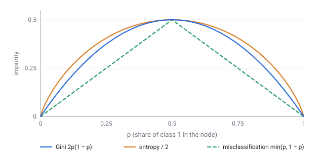

# Decision Trees

Recursively find the best split of the data, greedily optimizing a criterion.

```derivation
\Delta I & = I(\text{parent}) - \sum_{c\, \in\, \text{children}} \frac{n_c}{n}\, I(c) || || [!NOTE] greedy :: Pick the feature and threshold with the largest $\Delta I$, then recurse on each child. Locally best splits, no lookahead.
I_{\text{Gini}} & = 1 - \sum_{k=1}^{C} p_k^2 || || [!INTUITION] mislabel rate :: $p_k$ = share of class $k$ in the node. Gini is the chance a random sample is mislabeled if you label it randomly from the node's class mix. Classification.
I_{\text{entropy}} = H & = -\sum_{k=1}^{C} p_k \log_2 p_k || || classification; $\Delta H$ = information gain
I_{\text{MSE}} & = \frac{1}{n} \sum_{i=1}^{n} (y_i - \bar y)^2 || || regression; a leaf predicts its mean $\bar y$
```

<figure>
  
  <figcaption>Two-class node. All three are 0 for a pure node and peak at p = 0.5. Gini and entropy are strictly concave, so they reward splits that make children purer even when the majority class doesn't change; misclassification error often doesn't.</figcaption>
</figure>

---

## Good questions

<details class="q">
<summary>Why are trees grown greedily?</summary>

Finding the optimal tree is NP-hard. Greedy picks the locally best split at each node and never looks back.

</details>

<details class="q">
<summary>Why split on Gini or entropy instead of misclassification rate?</summary>

A split can make both children purer without changing either majority class: misclassification error doesn't change, so the split looks useless. Gini and entropy are strictly concave, so they reward it.

</details>

<details class="q">
<summary>Why does a single deep tree overfit?</summary>

High variance: a small change in the data changes an early split, and everything below it. Deep trees memorize. Fixes: pruning, depth limits, ensembles.

</details>

<details class="q">
<summary>Why don't trees need feature scaling?</summary>

Each split is a threshold on one feature, so any monotone transform of a feature gives the same tree.

</details>
