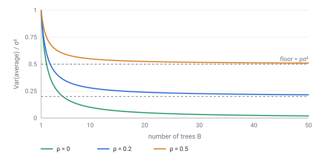

# Bagging & Boosting

Ensembles of trees.

## Bagging

```derivation
\hat f_{\text{bag}}(x) & = \frac{1}{B} \sum_{b=1}^{B} \hat f_b(x) || || each tree trained on a bootstrap sample; final score = average
\mathrm{Var}\big(\hat f_{\text{bag}}\big) & = \rho\, \sigma^2 + \frac{1 - \rho}{B}\, \sigma^2 || || [!INTUITION] reduces variance :: Averaging $B$ trees, each with variance $\sigma^2$ and pairwise correlation $\rho$. The second term vanishes as $B$ grows; the first doesn't. Random forests also subsample features at each split to lower $\rho$.
```

<figure>
  
  <figcaption>More trees help until the floor ρσ². Decorrelating the trees lowers the floor.</figcaption>
</figure>

---

## Boosting

```derivation
F_m(x) & = F_{m-1}(x) + \eta\, h_m(x) || || trees added in sequence; final score = weighted sum of trees
h_m & \approx \arg\min_h \sum_i \big(r_{im} - h(x_i)\big)^2 || || each tree learns to reduce the residuals
r_{im} & = y_i - F_{m-1}(x_i) = -\frac{\partial}{\partial F} \tfrac{1}{2}\big(y_i - F\big)^2 \Big|_{F = F_{m-1}(x_i)} || || [!INTUITION] gradient boosting :: Residuals are the negative gradient of squared loss. Swap in any differentiable loss and fit each tree to its negative gradient instead. [LambdaMART](../information-retrieval/1-foundations/02-lambdamart.md) does this with ranking "lambdas".
```

---

| | bagging | boosting |
|---|---|---|
| trees | independent, in parallel | sequential, each fixes the last |
| reduces | variance | bias and variance (mainly bias) |
| final score | average | weighted sum |
| more trees | never hurts, just plateaus | can overfit: shrink with $\eta$, stop early |
