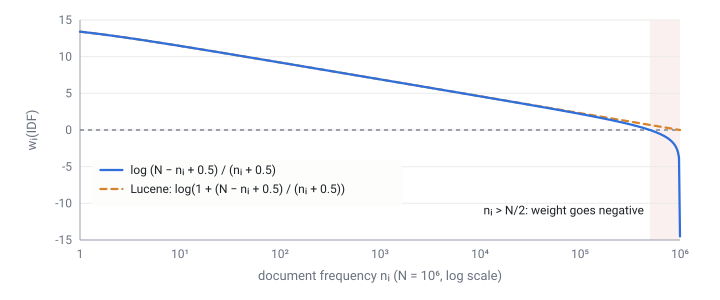
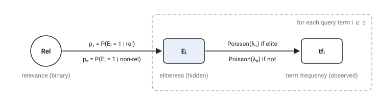
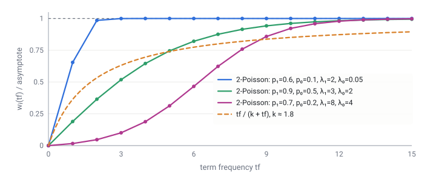
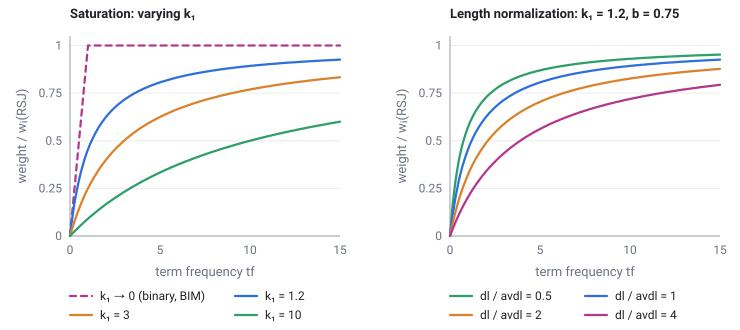

# BM25 & the Probabilistic Relevance Framework

**Robertson & Zaragoza — The Probabilistic Relevance Framework: BM25 and Beyond** · *Foundations and Trends in IR, 2009*

> **Why read it:** The theory behind BM25.

---

## From $P(\rel \mid d, q)$ to a sum of term weights

The main result: ranking by probability of relevance is the same as ranking by a sum of per-term weights, over query terms that appear in the document ($\propto_q$ = same ranking for query $q$).

$$
\boxed{\;P(\rel \mid d, q) \;\propto_q\; \sum_{i \in q,\ tf_i > 0} w_i\;}
$$

```derivation
P(\rel \mid d, q) & \propto_q \frac{P(\rel \mid d, q)}{P(\nrel \mid d, q)} || 2.1 || odds are monotonic in probability: same ordering
& = \frac{P(d \mid \rel, q)}{P(d \mid \nrel, q)} \cdot \frac{P(\rel \mid q)}{P(\nrel \mid q)} || 2.2 || Bayes' rule
& \propto_q \frac{P(d \mid \rel, q)}{P(d \mid \nrel, q)} || 2.3 || drop the prior odds: same for every doc
& \approx \prod_{i \in V} \frac{P(TF_i = tf_i \mid \rel, q)}{P(TF_i = tf_i \mid \nrel, q)} || 2.4 || [!ASSUMPTION] term independence :: Terms are **conditionally independent** given relevance (Naive Bayes). Since $d$ is just a tf vector, $P(d \mid \rel, q)$ then factorizes into per-term probabilities. Clearly false ("new", "york"), but weaker than it looks: two query terms that are each correlated with relevance are still predicted to co-occur. Cooper's weaker *linked dependence* assumption gives the same formula.
& \approx \prod_{i \in q} \frac{P(TF_i = tf_i \mid \rel)}{P(TF_i = tf_i \mid \nrel)} || 2.5 || [!ASSUMPTION] query terms only :: For non-query terms the ratio is 1, so they drop out. Not "they carry no information": with no link to the query, the neutral prior is that a random term isn't correlated with relevance. Query expansion revisits this.
& \propto_q \sum_{i \in q} \log \frac{P(TF_i = tf_i \mid \rel)}{P(TF_i = tf_i \mid \nrel)} || 2.6 || take the log: product → sum
& = \sum_{i \in q} U_i(tf_i) || 2.7 || $U_i(x)$: the log ratio at $TF_i = x$
& \propto_q \sum_{i \in q,\ tf_i > 0} \big[\, U_i(tf_i) - U_i(0) \,\big] || 2.8–2.10 || [!INTUITION] remove the zeros :: Subtract $\sum_{i \in q} U_i(0)$, a per-query constant. Every term with $tf_i = 0$ cancels, so only terms *in the document* remain.
& = \sum_{i \in q,\ tf_i > 0} w_i || 2.11 || $w_i := U_i(tf_i) - U_i(0)$
```

The weight of a query term that appears in the document:

$$
w_i = \log \frac{P(TF_i = tf_i \mid \rel)\; P(TF_i = 0 \mid \nrel)}{P(TF_i = tf_i \mid \nrel)\; P(TF_i = 0 \mid \rel)}
$$

- $P(TF_i = x \mid \rel)$: among relevant docs, how likely is the term to show up $x$ times?
- $P(TF_i = 0 \mid \nrel)$: among non-relevant docs, how likely is the term to show up zero times?

> [!INTUITION]
> **The big idea.** With some assumptions, $w_i$ can be computed **at index time**, and the sum only touches terms with $tf_i > 0$: an inverted-index lookup.

---

## Binary Independence Model (BIM)

Assume $TF_i$ is **binary** ($t_i$ = term $i$ is present):

$$
w_i^{\text{BIM}} = \log \frac{P(t_i \mid \rel)\,\big(1 - P(t_i \mid \nrel)\big)}{\big(1 - P(t_i \mid \rel)\big)\,P(t_i \mid \nrel)}
$$

> [!PROBLEM]
> $P(t_i \mid \rel)$ is impossible to know at index time. Relevance is a **query-time** concept!

### Estimating with relevance judgments

| | relevant | non-relevant | total |
|---|:-:|:-:|:-:|
| **contains $t_i$** | $r_i$ | $n_i - r_i$ | $n_i$ |
| **doesn't contain $t_i$** | $R - r_i$ | $N - R - n_i + r_i$ | $N - n_i$ |
| **total** | $R$ | $N - R$ | $N$ |

```derivation
P(t_i \mid \rel) & \approx \frac{r_i}{R} || || [!PROBLEM] zeros :: Blows up on the log scale: any zero count (e.g. $r_i = 0$) sends $w_i$ to $\pm\infty$.
w_i^{\text{RSJ}} & = \log \frac{(r_i + 0.5)\,(N - R - n_i + r_i + 0.5)}{(n_i - r_i + 0.5)\,(R - r_i + 0.5)} || 3.2 || [!INTUITION] odds ratio :: Robertson–Spärck Jones: the log odds ratio of the table above, with $0.5$ added to each cell.
```

### IDF: no relevance judgments

Assume every document not known to be relevant is irrelevant. Now $N$ is the whole collection and $n_i$ the number of documents containing $t_i$:

```derivation
P(t_i \mid \nrel) & \to \frac{n_i}{N} || || complement method
P(t_i \mid \rel) & \to 0.5 || || relevant-side odds become 1 and drop out
w_i^{\text{IDF}} & = \log \frac{N - n_i + 0.5}{n_i + 0.5} || 3.3 || RSJ with $R = r_i = 0$
```

<figure>
  
  <figcaption>IDF for a 1M-document collection. A term in more than half the collection gets a <em>negative</em> weight. Lucene adds 1 inside the log (dashed) to keep it positive.</figcaption>
</figure>

---

## Eliteness & the 2-Poisson model

Use **term frequencies**: insert a hidden binary variable, **eliteness**, between relevance and tf.

<figure>
  
  <figcaption>Relevance affects term frequency only through eliteness.</figcaption>
</figure>

**Eliteness** = the document is *about* the term. A document about cats is elite for "cats"; a recipe that mentions a cat is not.

> [!INTUITION]
> "A relevant document tends to be elite in the query's terms, and an elite document tends to repeat its terms."

```derivation
TF_i \mid E_i = e & \sim \mathrm{Poisson}(\lambda_{ie}) =: E_e(tf) || 3.7 || elite terms repeat more: $\lambda_{i1} > \lambda_{i0}$
P(TF_i = x \mid \rel) & = p_1 E_1(x) + (1 - p_1)\, E_0(x) =: M_1(x) || || $p_1 = P(\text{elite} \mid \rel)$
P(TF_i = x \mid \nrel) & = p_0 E_1(x) + (1 - p_0)\, E_0(x) =: M_0(x) || || $p_0 = P(\text{elite} \mid \nrel)$
w_i^{\text{elite}}(tf) & = \log \frac{M_1(tf)\; M_0(0)}{M_0(tf)\; M_1(0)} || 3.6 || [!PROBLEM] untenable :: Needs $\lambda_0, \lambda_1, p_0, p_1$ for every term. None can be estimated in practice.
```

### Saturation

The **shape** of $w_i^{\text{elite}}$ is what matters: $w(0) = 0$, increasing in $tf$, and saturating at the binary weight of eliteness itself.

```derivation
\lim_{tf \to \infty} w_i^{\text{elite}}(tf) & = \log \frac{p_1 (1 - p_0)}{(1 - p_1)\, p_0} || 3.8 || [!INTUITION] saturation :: The weight eliteness would get if we could observe it. More repetitions can't beat "definitely about this term". (Exact when elite documents always contain the term, $e^{-\lambda_1} \approx 0$.)
& = w_i^{\text{BIM}} \text{ (of eliteness)} || 3.9 ||
```

<figure>
  
  <figcaption>Exact 2-Poisson weights, normalized. Usually concave (blue, green), sometimes S-shaped (pink). tf/(k+tf) (dashed) shares the shape with one parameter. Cf. paper Fig. 3.2.</figcaption>
</figure>

> [!INTUITION]
> **Special case: tf·idf.** If eliteness *is* relevance ($p_1 = 1$, $p_0 = 0$), the limit is infinite and the weight is linear in $tf$. Saturating weights beat it in practice.

---

## BM25

```derivation
w_i(tf) & = \frac{tf}{k + tf}\; w_i^{\text{RSJ}} || 3.11 || [!INTUITION] precursor :: $\frac{tf}{k+tf}$ is a one-parameter curve fitted to the shape of $w_i^{\text{elite}}$, and $w_i^{\text{RSJ}}$ (= $w_i^{\text{IDF}}$ without judgments) stands in for its asymptote. Everything else is precomputed. This can be fast!!
w_i^{\text{BM25}}(tf) & = \frac{tf}{k_1\left[(1-b) + b\,\frac{dl}{avdl}\right] + tf}\; w_i^{\text{RSJ}} || 3.15 || $b \in [0, 1]$: how much length normalization
\mathrm{BM25}(d, q) & = \sum_{i \in q,\ tf_i > 0} \frac{tf_i\,(k_1 + 1)}{k_1\left[(1-b) + b\,\frac{dl}{avdl}\right] + tf_i}\; w_i^{\text{IDF}} || || [!NOTE] the (k₁+1) factor :: The $(k_1 + 1)$ factor makes one occurrence in an average-length document score exactly $w_i$, as in RSJ alone. Same factor for every term, so the ranking doesn't change.
```

<figure>
  
  <figcaption>Left: k₁ moves from binary matching (k₁ → 0) toward linear tf (large k₁). Right: longer documents need more occurrences for the same weight.</figcaption>
</figure>

$b$ trades off two rationales for long documents:

- **Verbosity:** more words to say the same thing → $tf' = tf / dl$ ($b = 1$).
- **Scope:** covers more ground → $tf' = tf$ ($b = 0$).

Tuned empirically: $1.2 < k_1 < 2$, $0.5 < b < 0.8$ work well in many settings.

---

## BM25F: multiple fields

Documents split into fields $s = 1, \dots, S$ (title, body, anchor text) with weights $v_s$. Combine the fields **first**, then saturate once.

```derivation
\widetilde{tf}_i & = \sum_{s=1}^{S} v_s\, \frac{tf_{si}}{B_s} || 3.19 || [!INTUITION] fields first, then saturate :: Eliteness is a property of the term and the *document*, shared across its fields. So pool the evidence across fields, then saturate once. Scoring each field with BM25 and summing would saturate every field separately, as if title and body eliteness were independent.
B_s & = (1 - b_s) + b_s\, \frac{sl_s}{avsl_s} || 3.20 || per-field length normalization
w_i^{\text{BM25F}} & = \frac{\widetilde{tf}_i}{k_1 + \widetilde{tf}_i}\; w_i^{\text{RSJ}} || 3.21 || [!NOTE] simple version :: With one shared $b$: $\widetilde{tf}_i = \sum_s v_s\, tf_{si}$ and $\widetilde{dl} = \sum_s v_s\, sl_s$ go straight into plain BM25 (3.18). With integer $v_s$ that's BM25 on a document whose fields are copied $v_s$ times: $v_{\text{title}} = 5$ means the title repeated 5 times.
```

Tuned on TREC 2003 web search: $v_{\text{title}} \approx 38$, $v_{\text{anchor}} \approx 35$, $v_{\text{body}} = 1$. Title and anchor matches are far stronger evidence than body matches.

---

## Takeaways & interview angles

- **Why is BM25 still a strong baseline?** Principled derivation (PRP + eliteness), two parameters, no training data to overfit, and it captures the two tf effects that matter: saturation and length. Hence BEIR (#12).
- **Why does it scale?** A sum of precomputable per-term weights over $q \cap d$: an inverted-index lookup.
- **Two knobs:** $k_1$ = saturation speed (binary ↔ linear); $b$ = verbosity vs. scope.
- **Multiple fields (BM25F):** weight and sum the fields' tf, then saturate once. Don't sum per-field BM25 scores.
- **IDF is principled:** the RSJ weight with no relevance information.
- **Assumptions:** binary relevance, documents judged independently (no diversity), conditional term independence, neutral prior on non-query terms.
- **Scores aren't probabilities:** rank-preserving steps dropped terms like the prior odds in (2.3), so raw scores can't be thresholded or calibrated (§2.5).

## Open questions

- The PRP judges documents independently. How do you rank for diversity, when result 2 should depend on result 1?
