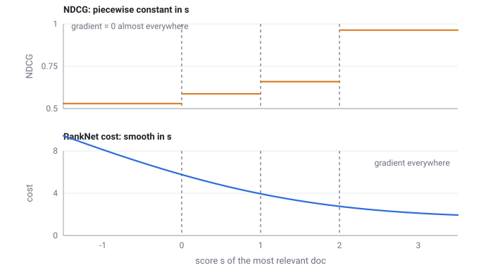
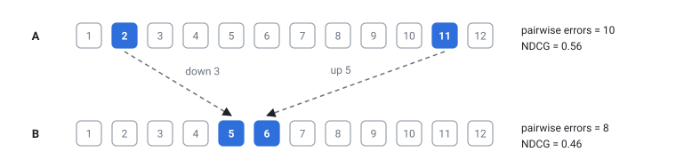
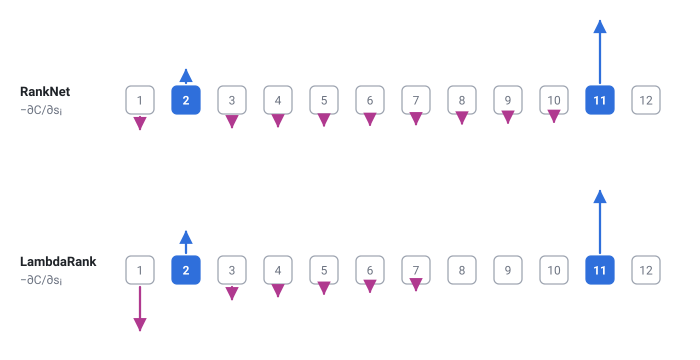

# RankNet → LambdaRank → LambdaMART

**Burges — From RankNet to LambdaRank to LambdaMART: An Overview** · *MSR Tech Report, 2010*

> **Why read it:** Pairwise gradients, weighted by ΔNDCG.

---

## The lambda

The main result: you don't need a differentiable NDCG. Take RankNet's pairwise gradient, scale it by how much NDCG would change if $i$ and $j$ swapped, and fit boosted trees to it.

$$
\boxed{\;\lambda_{ij} = \frac{-\sigma}{1 + e^{\sigma (s_i - s_j)}}\,\big|\Delta \mathrm{NDCG}_{ij}\big|\;}
$$

---

## RankNet: pairwise learning to rank

Training data: pairs $U_i \rhd U_j$ (doc $i$ should rank above doc $j$, same query). $S_{ij} \in \{1, 0, -1\}$: $i$ is more / equally / less relevant than $j$.

```derivation
s_i & = f(x_i), \quad x_i \in \mathbb{R}^n || || model score, e.g. a neural net
P_{ij} & = P(U_i \rhd U_j) = \frac{1}{1 + e^{-\sigma (s_i - s_j)}} || || sigmoid of the score gap
C_{ij} & = -\bar P_{ij} \log P_{ij} - (1 - \bar P_{ij}) \log (1 - P_{ij}) || || cross-entropy, target $\bar P_{ij} = \tfrac12 (1 + S_{ij})$
& = \tfrac12 (1 - S_{ij})\, \sigma (s_i - s_j) + \log\big(1 + e^{-\sigma (s_i - s_j)}\big) || || [!INTUITION] margin :: At $s_i = s_j$ the cost is $\log 2$, not 0, so docs with different labels are pushed apart even when tied. With $S_{ij} = 1$ it's just the [logistic loss](../../classical-ml/03-logistic-regression.md) on the score gap.
w_k & \to w_k - \eta\, \frac{\partial C}{\partial w_k} || || SGD, one pair at a time
```

### The factorization trick → lambdas

```derivation
\frac{\partial C}{\partial s_i} & = \sigma \Big[ \tfrac12 (1 - S_{ij}) - \frac{1}{1 + e^{\sigma (s_i - s_j)}} \Big] = -\frac{\partial C}{\partial s_j} || || symmetric in $i, j$
\frac{\partial C}{\partial w_k} & = \frac{\partial C}{\partial s_i} \frac{\partial s_i}{\partial w_k} + \frac{\partial C}{\partial s_j} \frac{\partial s_j}{\partial w_k} || || [!ASSUMPTION] partials exist :: Chain rule: needs $\partial s_i / \partial w_k$, so $f$ must be differentiable in its weights (a neural net). The cost works for any model, but trees need a different route: MART (below).
& = \lambda_{ij} \Big( \frac{\partial s_i}{\partial w_k} - \frac{\partial s_j}{\partial w_k} \Big) || || $\lambda_{ij} \equiv \partial C / \partial s_i$
\lambda_{ij} & = \frac{-\sigma}{1 + e^{\sigma (s_i - s_j)}} || || keep only $I = \{(i, j) : U_i \rhd U_j\}$, so $S_{ij} = 1$
\delta w_k & = -\eta \sum_{(i, j) \in I} \Big( \lambda_{ij} \frac{\partial s_i}{\partial w_k} - \lambda_{ij} \frac{\partial s_j}{\partial w_k} \Big) || || sum the updates over a query's pairs
& = -\eta \sum_i \lambda_i \frac{\partial s_i}{\partial w_k} || || [!INTUITION] O(n²) → O(n) :: The $\lambda_{ij}$ are cheap scalars (still one per pair). The expensive part, a backprop for $\partial s_i / \partial w_k$, now runs once per **doc** instead of once per **pair**: one weight update per query.
\lambda_i & = \sum_{j : (i, j) \in I} \lambda_{ij} - \sum_{j : (j, i) \in I} \lambda_{ji} || || [!INTUITION] little arrows :: Every doc gets one force $-\lambda_i$: which way its score should move, and how hard. It's the sum of the pushes from every pair the doc is in: up from docs it should beat, down from docs that should beat it.
```

---

## LambdaRank

> [!PROBLEM]
> IR metrics (NDCG, MRR, MAP, ERR) depend on the scores only through the **sorted order**. As a function of $w$ they're flat or discontinuous: the gradient is 0 or undefined.

<figure>
  
  <figcaption>Slide one doc's score s past three others. NDCG only changes when the order changes. RankNet's cost always has a slope.</figcaption>
</figure>

> [!PROBLEM]
> RankNet minimizes a smooth proxy for the **number of pairwise errors**. NDCG cares mostly about the **top**. The two can disagree.

<figure>
  
  <figcaption>B has fewer pairwise errors than A (8 vs. 10), so RankNet prefers it. But it lost the relevant doc at rank 2, so NDCG drops from 0.56 to 0.46.</figcaption>
</figure>

### Key idea: scale each $\lambda_{ij}$ by the metric

```derivation
\lambda_{ij} & = \frac{-\sigma}{1 + e^{\sigma (s_i - s_j)}}\, \big| \Delta \mathrm{NDCG}_{ij} \big| || || RankNet $\lambda_{ij}$ × NDCG change from swapping $i$ and $j$
\big| \Delta \mathrm{NDCG}_{ij} \big| & = \frac{\big| G_i - G_j \big| \cdot \Big| \frac{1}{\log_2 (1 + r_i)} - \frac{1}{\log_2 (1 + r_j)} \Big|}{\mathrm{IDCG}} || || $G = 2^{\ell} - 1$, $r$ = current rank; [!INTUITION] top-heavy :: The discount changes fastest near the top, so pairs involving the top ranks get the biggest lambdas. Needs a sort by the current scores.
C & = \sum_{(i, j) \in I} \big| \Delta \mathrm{NDCG}_{ij} \big| \log\big( 1 + e^{-\sigma (s_i - s_j)} \big) || || [!NOTE] the implicit cost :: You only specify the gradient. Treating $|\Delta \mathrm{NDCG}_{ij}|$ as constant, this is the cost it comes from. Shown empirically to find a local optimum of NDCG itself (Donmez et al., 2009).
```

<figure>
  
  <figcaption>Ranking A, arrows = −λᵢ (each row scaled to its largest arrow). RankNet pushes every non-relevant doc down about equally. LambdaRank puts the force at the top: the non-relevant doc at rank 1 gets the biggest push down.</figcaption>
</figure>

---

## MART: boosted regression trees

The output is a linear combination of regression trees. A [regression tree](../../classical-ml/05-decision-trees.md) on $\{x_i, y_i\}$, $x_i \in \mathbb{R}^d$, $y_i \in \mathbb{R}$:

```derivation
S_j(t) & = \sum_{i \in L} (y_i - \mu_L)^2 + \sum_{i \in R} (y_i - \mu_R)^2 || || split on feature $j$ at threshold $t$; $\mu$ = mean $y$ on each side
(j^*, t^*) & = \arg\min_{j,\, t}\ S_j(t) || || greedy; repeat until $L$ leaves
```

[Boosting](../../classical-ml/06-bagging-boosting.md) the trees:

```derivation
F_N(x) & = \sum_{n=1}^{N} \alpha_n f_n(x) || || [!INTUITION] nudge the score :: "Given what the first $n - 1$ trees predict, how much should I nudge the score?"
\tilde y_i & = -\frac{\partial C}{\partial F(x_i)} \Big|_{F = F_{n-1}} || || tree $n$ fits the negative gradient (= residuals for squared loss)
\Delta C & \approx \frac{\partial C}{\partial F}\, \Delta F || || first-order Taylor
\Delta F = -\eta \frac{\partial C}{\partial F} \ \Rightarrow\ \Delta C & \approx -\eta \Big( \frac{\partial C}{\partial F} \Big)^2 \leq 0 || || gradient descent in function space
```

---

## LambdaMART = MART fit to lambdas

All the ideas together. Each tree models the lambda gradient, with any IR metric $Z$ in place of NDCG.

```derivation
\frac{\partial C}{\partial s_i} & = \sum_{\{i, j\} \rightleftharpoons I} \frac{-\sigma\, |\Delta Z_{ij}|}{1 + e^{\sigma (s_i - s_j)}} = \lambda_i || || [!NOTE] notation :: $\sum_{\{i,j\} \rightleftharpoons I} \lambda_{ij} \equiv \sum_{j : (i,j) \in I} \lambda_{ij} - \sum_{j : (j,i) \in I} \lambda_{ji}$. $Z$ = NDCG, MAP, ERR, ...
\tilde y_i & = -\lambda_i || || tree $m$ fits the arrows
\gamma_{lm} & = \frac{\sum_{x_i \in R_{lm}} (-\lambda_i)}{\sum_{x_i \in R_{lm}} \partial^2 C / \partial s_i^2} || || [!INTUITION] Newton leaves :: The leaf value is not the mean gradient. It's one Newton step: sum of the $\lambda$'s in the leaf divided by the second derivative.
\frac{\partial^2 C}{\partial s_i^2} & = \sum_{j \sim i} \sigma^2\, |\Delta Z_{ij}|\, \rho_{ij} (1 - \rho_{ij}), \quad \rho_{ij} = \frac{1}{1 + e^{\sigma (s_i - s_j)}} || || $j \sim i$: every pair containing $i$
F_m(x) & = F_{m-1}(x) + \eta \sum_l \gamma_{lm}\, \mathbf{1}[x \in R_{lm}] || || add the tree; re-sort, recompute the $\lambda$'s
```

---

## Takeaways & interview angles

- **The lambda trick:** specify the gradient, not the cost. Works for any metric $Z$ you can compute a swap delta for.
- **RankNet = logistic loss on score gaps** $s_i - s_j$, trained on pairs.
- **Speed:** the factorization makes backprops $O(n)$ per query; the $\lambda_{ij}$ are still $O(n^2)$ scalars. For NDCG@k, pairs with both docs below rank $k$ have $\Delta = 0$ and can be skipped.
- **LambdaMART = LambdaRank's gradients + MART's trees** (Newton-step leaves). Won the 2010 Yahoo! LTR Challenge; it's `lambdarank` in LightGBM and `rank:ndcg` in XGBoost.
- **Why trees in production:** tabular, heterogeneous features (BM25, clicks, freshness), no scaling needed, fast and interpretable.

## Open questions

- The lambdas aren't the gradient of any fixed cost ($|\Delta Z|$ changes with the order). What is LambdaMART actually minimizing? (LambdaLoss, Wang et al. 2018.)

---

## Appendix: MART for binary classification

Useful for walking through the math; not needed for the paper's main idea. Labels $y_i \in \{-1, 1\}$.

```derivation
L(y, F) & = \log\big( 1 + e^{-2 y \sigma F} \big) || || logistic loss; $2\sigma F$ = log-odds
\tilde y_i & = -\frac{\partial L(y_i, F(x_i))}{\partial F(x_i)} \Big|_{F = F_{m-1}} = \frac{2 y_i \sigma}{1 + e^{2 y_i \sigma F_{m-1}(x_i)}} || || what regression tree $m$ fits
\gamma_{lm} & = \frac{\sum_{x_i \in R_{lm}} \tilde y_i}{\sum_{x_i \in R_{lm}} |\tilde y_i| \big( 2\sigma - |\tilde y_i| \big)} || || Newton step per leaf: the same trick LambdaMART uses
```
