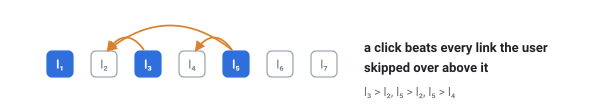
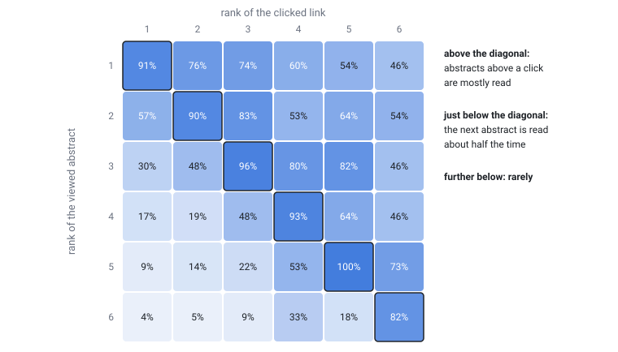
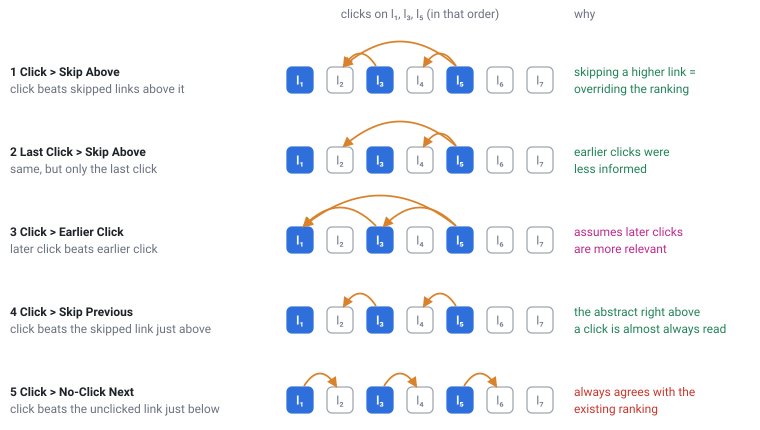

# Clickthrough Data as Implicit Feedback

**Joachims et al. — Accurately Interpreting Clickthrough Data as Implicit Feedback** · *SIGIR 2005*

> **Why read it:** Clicks are relative, not absolute.

**Companion reading:**

- Chapelle & Zhang — A Dynamic Bayesian Network Click Model for Web Search Ranking (WWW 2009): modeling examination versus attractiveness

---

## Clicks → pairwise preferences

The main result: a click is not a reliable "this is relevant" label. But a click on a link the user **scrolled past others to reach** is a reliable "this beats the ones I skipped".

<figure>
  
  <figcaption>Clicked links in blue. Each arc goes from the preferred link to a link it beats.</figcaption>
</figure>

These preferences agree with human judges **~81–83%** of the time. Two human judges agree with each other **89.5%** of the time.

---

## The experiment

Is clickthrough data a reliable relevance signal? Users searched Google while an eye tracker recorded what they read.

| | Phase I | Phase II |
|---|---|---|
| participants (usable eye tracking) | 34 (29) | 22 (16) |
| results page | Google's ranking | **normal**, **swapped** (top two switched) or **reversed** |

Each participant answered the same 10 questions:

- **Navigational** (find a specific page): "Find the homepage of Michael Jordan, the statistician."
- **Informational** (find a fact, any site): "Where is the tallest mountain in New York located?"

> [!NOTE]
> **Ground truth.** Judges *ordered* the abstracts by how promising they looked, instead of scoring each one. People are more reliable at relative judgments than absolute ones. Judges agreed on 89.5% of strict preferences (Phase I).

> [!NOTE]
> **Eye-tracking basics.** A *fixation* is a steady gaze of 200–300 ms, when most information is taken in. A *saccade* is a 40–50 ms jump between fixations, during which little is absorbed. Pupil dilation (arousal, interest) wasn't used.

---

## How users read the results page

- **Top to bottom.** Ranks 1 and 2 are seen within the first 2–3 fixations; everything below the fold comes much later.
- **Rank 1 gets far more clicks than rank 2,** even though both get about the same number of fixations.
- **Clicks low on the page come after reading more abstracts**, mostly above the click and a few below it.

<figure>
  
  <figcaption>Paper's Table 2: how often the abstract at each rank (rows) was viewed before a click at each rank (columns). Abstracts just above a click are almost always read; the one just below is read about half the time.</figcaption>
</figure>

---

## Clicks are not absolute relevance judgments

Users react to quality: in the **reversed** condition they scan significantly more abstracts and click lower (mean clicked rank 2.66 → 4.03). So clicks carry relevance information. But two biases make "clicked = relevant" wrong.

**Trust bias.** Queries where exactly one of the top two links was clicked (normal condition):

```derivation
P(\text{click the more relevant link} \mid \text{it's at rank } 1) & = 19 / 20 || || [!PROBLEM] trust bias :: Same relevance gap, opposite decisions: users click rank 1 even when rank 2 is better. They trust the engine's order. The swapped condition shows the same pattern.
P(\text{click the more relevant link} \mid \text{it's at rank } 2) & = 2 / 7 || || position flips the decision
```

**Quality bias.** Worse results → users click worse abstracts:

| | normal / swapped | reversed |
|---|:-:|:-:|
| mean **judged relevance rank** of the clicked abstract (clicks in the top 5) | 2.67 | 3.27 |

> [!PROBLEM]
> A click means "the best of what I saw", which depends on what else was shown. It's relative to both the **position** and the **quality** of the rest of the list.

---

## Five strategies for extracting preferences

<figure>
  
  <figcaption>Same clicks, five ways to read them. Arcs go from the preferred link to the link it beats. Why: green = intuition, pink = assumption, red = problem. Strategies 1, 2 and 4 only produce "lower beats higher" pairs; strategy 5 only produces "higher beats lower".</figcaption>
</figure>

> [!NOTE]
> **Why no preference for l₁ in strategy 1?** Nothing was skipped to reach it, so that click could be pure trust in the ranking.

---

## Which strategy agrees with human judgments?

% of click-derived preferences that match a judge's strict preference (random = 50). Paper's Table 4, ± = 95% binomial interval.

| strategy | Phase I normal | Phase II normal | swapped | reversed | Phase II all | **pages**, Phase II all |
|---|:-:|:-:|:-:|:-:|:-:|:-:|
| *inter-judge agreement* | *89.5* | — | — | — | *82.5* | *86.4* |
| 1 Click > Skip Above | 80.8&nbsp;<small>±3.6</small> | 88.0&nbsp;<small>±9.5</small> | 79.6&nbsp;<small>±8.9</small> | 83.0&nbsp;<small>±6.7</small> | 83.1&nbsp;<small>±4.4</small> | 78.2&nbsp;<small>±5.6</small> |
| 2 Last Click > Skip Above | **83.1**&nbsp;<small>±3.8</small> | **89.7**&nbsp;<small>±9.8</small> | 77.9&nbsp;<small>±9.9</small> | **84.6**&nbsp;<small>±6.9</small> | **83.8**&nbsp;<small>±4.6</small> | **80.9**&nbsp;<small>±5.1</small> |
| 3 Click > Earlier Click | 67.2&nbsp;<small>±12.3</small> | 75.0&nbsp;<small>±25.8</small> | 36.8&nbsp;<small>±22.9</small> | 28.6&nbsp;<small>±27.5</small> | 46.9&nbsp;<small>±13.9</small> | 64.3&nbsp;<small>±15.4</small> |
| 4 Click > Skip Previous | 82.3&nbsp;<small>±7.3</small> | 88.9&nbsp;<small>±24.1</small> | **80.0**&nbsp;<small>±18.0</small> | 79.5&nbsp;<small>±15.4</small> | 81.6&nbsp;<small>±9.5</small> | 80.7&nbsp;<small>±9.6</small> |
| 5 Click > No-Click Next | 84.1&nbsp;<small>±4.9</small> | 75.6&nbsp;<small>±14.5</small> | 66.7&nbsp;<small>±13.1</small> | 70.0&nbsp;<small>±15.7</small> | 70.4&nbsp;<small>±8.0</small> | 67.4&nbsp;<small>±8.2</small> |

- **Strategies 1, 2, 4 work, and survive swapped / reversed rankings:** the preferences handle both trust bias and quality bias. 2 is slightly better than 1 (significant in Phase I only); 4 is not significantly different from 1.
- **Strategy 3 fails:** 46.9% on Phase II, below random. It's worst on reversed rankings, where users scan more before their first click, so even early clicks are well informed.
- **Strategy 5 looks best on Phase I (84.1%), but that's misleading.** Its pairs always agree with Google's order, so a user who blindly clicks rank 1 every time would already score 62.4%. And pairs that confirm the current ranking teach a learner little. The reversed condition (70.0%) is the fairer test: better than random, worse than strategy 1.
- **Pages vs. abstracts** (last two columns): agreement with judgments of the actual page is ~3% lower. The exception is strategy 3, which goes up: a misleading abstract gets the first click, the user comes back and clicks the right one.

---

## Takeaways

- **Clicks are informative but biased:** use them as **relative** preferences, never as absolute labels.
- **Trust bias:** position changes clicks even when relevance doesn't. **Quality bias:** what's clicked depends on what else was shown.
- **"Click > Skip Above"** pairs agree with human judges ~81–83% of the time, close to judge-vs-judge agreement (89.5%), and hold up on degraded rankings.
- **Pairwise output fits pairwise learners:** RankSVM, RankNet / LambdaMART ([#2](02-lambdamart.md)).
- **Clicks are free and plentiful.** Slightly lower quality than explicit labels, but orders of magnitude more of them.

## Open questions

- These are hand-made rules. Can you model examination vs. attractiveness explicitly (click models, e.g. the DBN in the companion reading) and debias properly ([#4](04-unbiased-ltr.md))?
- 34 undergrads, 10 questions, one 2005 results page. How much transfers to modern SERPs with ads, snippets, answer boxes and mobile?

---

## Good questions

<details class="q">
<summary>Why can't you treat a click as a "relevant" label?</summary>

Because whether a doc gets clicked depends on more than its relevance. Trust bias: users click rank 1 even when rank 2 is better. Quality bias: in a bad list they click worse docs. A click only says "best of what I looked at, given where it was".

</details>

<details class="q">
<summary>Why does Click > Skip Above hold up against both biases?</summary>

It only fires when the user went *against* the ranking by skipping a higher link, which trust can't explain. And it only compares docs within the same list the user saw, so it doesn't matter whether the list as a whole was good or bad.

</details>

<details class="q">
<summary>Why is Click > No-Click Next's high accuracy suspicious?</summary>

Every pair it makes agrees with the existing ranking, so it beats 50% even for a user who ignores relevance (62.4% for always clicking rank 1). Pairs that only confirm the current order also give a learner nothing to fix.

</details>

<details class="q">
<summary>What goes wrong if you train only on Click > Skip Above pairs?</summary>

Every pair says "a lower doc beats a higher one", so the data systematically disagrees with the current ranking, and a learner can be pushed to just flip it. You also learn nothing about docs below the last click, which users never read. That's the presentation bias unbiased LTR ([#4](04-unbiased-ltr.md)) corrects for.

</details>

<details class="q">
<summary>Why did the judges rank abstracts instead of scoring them?</summary>

People are more consistent at "A is better than B" than at assigning absolute scores. It also puts the ground truth in the same pairwise form as the click-derived preferences being tested.

</details>
